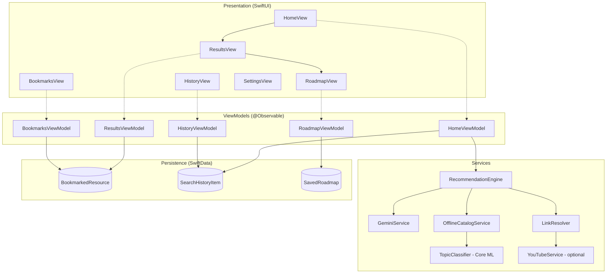
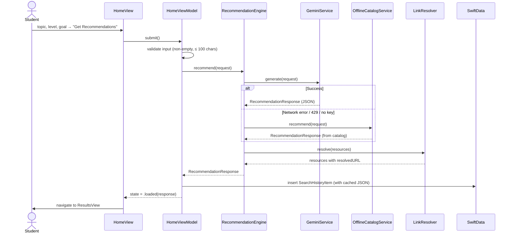

# LearnWise: Architecture

This document describes how LearnWise is built: its layers, modules, data models, the recommendation pipeline, persistence, and the testing strategy.

---

## 1. Overview

LearnWise uses **MVVM with a Service layer**:

- **Views** (SwiftUI) render state and send user intents.
- **ViewModels** (`@Observable`, `@MainActor`) hold screen state and call services.
- **Services** contain the business logic: talking to Gemini, resolving links, offline fallback, Core ML.
- **Persistence** (SwiftData) stores bookmarks, search history, and saved roadmaps.

Every service sits behind a **protocol**, so ViewModels can be unit-tested with mocks.



---

## 2. Xcode Project Structure

```
LearnWise/
├── LearnWise.xcodeproj
├── LearnWise/
│   ├── App/
│   │   ├── LearnWiseApp.swift            # @main, attaches .modelContainer
│   │   ├── RootTabView.swift             # TabView: Discover, Bookmarks, History, Settings
│   │   └── AppEnvironment.swift          # Dependency container (services)
│   │
│   ├── Config/
│   │   ├── Secrets.example.xcconfig      # Template (committed)
│   │   ├── Secrets.xcconfig              # Real keys (gitignored)
│   │   └── AppConfig.swift               # Reads keys from Info.plist
│   │
│   ├── Models/
│   │   ├── SkillLevel.swift
│   │   ├── ResourceType.swift
│   │   ├── LearningRequest.swift
│   │   ├── Resource.swift
│   │   ├── RoadmapStep.swift
│   │   ├── RecommendationResponse.swift
│   │   └── SwiftData/
│   │       ├── BookmarkedResource.swift
│   │       ├── SearchHistoryItem.swift
│   │       └── SavedRoadmap.swift
│   │
│   ├── Views/
│   │   ├── Home/
│   │   │   ├── HomeView.swift
│   │   │   └── SkillLevelPicker.swift
│   │   ├── Results/
│   │   │   ├── ResultsView.swift
│   │   │   └── ResourceSectionView.swift
│   │   ├── ResourceDetail/
│   │   │   └── ResourceDetailView.swift
│   │   ├── Roadmap/
│   │   │   ├── RoadmapView.swift
│   │   │   └── RoadmapStepRow.swift
│   │   ├── Bookmarks/
│   │   │   └── BookmarksView.swift
│   │   ├── History/
│   │   │   └── HistoryView.swift
│   │   ├── Settings/
│   │   │   └── SettingsView.swift
│   │   └── Components/
│   │       ├── ResourceCard.swift
│   │       ├── ResourceTypeBadge.swift
│   │       ├── LoadingView.swift
│   │       ├── ErrorStateView.swift
│   │       ├── EmptyStateView.swift
│   │       └── SafariView.swift          # UIViewControllerRepresentable for SFSafariViewController
│   │
│   ├── ViewModels/
│   │   ├── HomeViewModel.swift
│   │   ├── ResultsViewModel.swift
│   │   ├── RoadmapViewModel.swift
│   │   ├── BookmarksViewModel.swift
│   │   └── HistoryViewModel.swift
│   │
│   ├── Services/
│   │   ├── Protocols/
│   │   │   ├── RecommendationProviding.swift
│   │   │   └── LinkResolving.swift
│   │   ├── RecommendationEngine.swift    # Orchestrator: Gemini → fallback → resolve
│   │   ├── Gemini/
│   │   │   ├── GeminiService.swift
│   │   │   ├── GeminiRequest.swift       # Request/response DTOs
│   │   │   └── PromptBuilder.swift       # Prompt + JSON schema
│   │   ├── LinkResolver.swift
│   │   ├── YouTubeService.swift          # Optional, YouTube Data API v3
│   │   ├── OfflineCatalogService.swift
│   │   └── TopicClassifier.swift         # Core ML wrapper
│   │
│   ├── Persistence/
│   │   ├── PersistenceController.swift   # ModelContainer config + preview container
│   │   ├── ModelContext+LearnWise.swift  # Bookmark toggle, record/trim history
│   │   └── SampleData.swift              # Preview / test fixtures
│   │
│   ├── Utilities/
│   │   ├── AppError.swift
│   │   ├── Constants.swift               # Endpoints, limits, link allow-lists
│   │   ├── JSONValue.swift               # Encodes Gemini's responseSchema
│   │   └── Extensions/
│   │       ├── String+Trimming.swift
│   │       └── URL+Search.swift
│   │
│   └── Resources/
│       ├── Assets.xcassets
│       ├── resources_catalog.json        # Offline curated catalog
│       └── TopicClassifier.mlmodel       # Optional, trained in Create ML
│
├── LearnWiseTests/
│   ├── RecommendationDecodingTests.swift
│   ├── LinkResolverTests.swift
│   ├── RecommendationEngineTests.swift
│   ├── HomeViewModelTests.swift
│   └── Mocks/
│       ├── MockGeminiService.swift       # Also MockYouTubeService
│       ├── Fixtures.swift                # Loads the sample JSON, wraps it in a Gemini envelope
│       └── gemini_sample_response.json   # Example model output (the inner JSON payload)
│
├── LearnWiseUITests/
│   └── RecommendationFlowUITests.swift
│
└── Tools/                                # Not part of the app target
    ├── gemini_request.json               # Same prompt and schema as PromptBuilder.swift
    └── test_gemini.ps1                   # Calls Gemini from Windows/PowerShell to test prompts
```

> `LinkResolving.swift` also declares the `YouTubeSearching` protocol.

---

## 3. Data Models

### 3.1 Value types (Codable, used for networking and UI)

```swift
enum SkillLevel: String, Codable, CaseIterable, Identifiable {
    case beginner, intermediate, advanced
    var id: String { rawValue }
}

enum ResourceType: String, Codable, CaseIterable, Identifiable {
    case video      // YouTube
    case pdf
    case course     // Coursera, edX, NPTEL, Udemy, freeCodeCamp…
    case leetcode   // LeetCode / practice problems
    case notes      // Articles, docs, blogs, GeeksforGeeks…
    var id: String { rawValue }
}

struct LearningRequest: Codable, Hashable {
    let topic: String
    let level: SkillLevel
    let goal: String?
}

struct Resource: Codable, Identifiable, Hashable {
    var id: UUID = UUID()
    let title: String
    let type: ResourceType
    let description: String
    let source: String            // "YouTube", "LeetCode", "MIT OCW"…
    let difficulty: SkillLevel
    let estimatedMinutes: Int?
    let url: String?              // Model-suggested URL (untrusted)
    let searchQuery: String?      // Used to build a safe fallback link
    let leetcodeSlug: String?     // e.g. "climbing-stairs"
    var resolvedURL: URL?         // Filled in by LinkResolver
}

struct RoadmapStep: Codable, Identifiable, Hashable {
    var id: UUID = UUID()
    let order: Int
    let title: String
    let summary: String
    let resourceTitles: [String]  // Links to resources by title
    let estimatedHours: Double
}

struct RecommendationResponse: Codable {
    let topic: String
    let category: String          // "DSA", "Web", "ML", "Math"…
    let resources: [Resource]
    let roadmap: [RoadmapStep]
    let tips: [String]
    var isOffline: Bool           // True when the offline catalog answered
}
```

> Gemini never sends `id`, `resolvedURL` or `isOffline`. The custom `init(from:)` decodes them only if they're present (they are in cached history), and otherwise generates or defaults them. Unknown `type`/`difficulty` values fall back to `.notes`/`.beginner` instead of failing the whole response.

### 3.2 SwiftData models (persisted)

```swift
@Model final class BookmarkedResource {
    @Attribute(.unique) var key: String   // "\(type)-\(title)" for de-duplication
    var title: String
    var typeRaw: String
    var summary: String
    var source: String
    var difficultyRaw: String
    var urlString: String
    var topic: String
    var createdAt: Date
}

@Model final class SearchHistoryItem {
    var topic: String
    var levelRaw: String
    var goal: String?
    var searchedAt: Date
    @Attribute(.externalStorage)
    var cachedResponse: Data?             // JSON-encoded RecommendationResponse for offline re-open
}

@Model final class SavedRoadmap {
    var topic: String
    var levelRaw: String
    var createdAt: Date
    @Attribute(.externalStorage)
    var responseData: Data                // Whole JSON-encoded response, so steps keep their resource links
    var completedStepOrders: [Int]        // Progress tracking
}
```

Shared write logic lives in `ModelContext+LearnWise.swift`: `toggleBookmark(_:topic:)`, `isBookmarked(_:)`, `recordSearch(_:response:)` (which replaces a duplicate search and trims history to 50 items), and `clearHistory()`.

The container is attached once in `LearnWiseApp`:

```swift
.modelContainer(for: [BookmarkedResource.self, SearchHistoryItem.self, SavedRoadmap.self])
```

---

## 4. Recommendation Pipeline

### 4.1 Sequence



### 4.2 `RecommendationProviding` protocol

```swift
protocol RecommendationProviding {
    func recommend(for request: LearningRequest) async throws -> RecommendationResponse
}
```
`GeminiService`, `OfflineCatalogService`, and `MockGeminiService` all conform. `RecommendationEngine` composes them: it tries the primary provider, falls back to the offline one, and then runs the result through the `LinkResolver`.

### 4.3 Gemini call

**Endpoint**
```
POST https://generativelanguage.googleapis.com/v1beta/models/{GEMINI_MODEL}:generateContent
Header: x-goog-api-key: {GEMINI_API_KEY}
Header: Content-Type: application/json
```

**Request body (simplified)**
```json
{
  "systemInstruction": { "parts": [{ "text": "<system prompt>" }] },
  "contents": [{ "role": "user", "parts": [{ "text": "<user prompt>" }] }],
  "generationConfig": {
    "temperature": 0.4,
    "responseMimeType": "application/json",
    "responseSchema": { "...": "see 4.5" }
  }
}
```

The response text is at `candidates[0].content.parts[0].text`. Because `responseMimeType` is JSON, that text decodes straight into `RecommendationResponse`.

### 4.4 Prompt template (`PromptBuilder`)

**System prompt**
```
You are LearnWise, an expert study advisor for university students.
Recommend high-quality, FREE-first learning resources.
Rules:
- Return 8–15 resources covering these types where relevant: video, pdf, course, leetcode, notes.
- Only include "leetcode" items for programming / DSA topics; use real LeetCode problem slugs.
- Match difficulty to the student's level; for beginners prefer fundamentals.
- Prefer well-known sources (YouTube channels like freeCodeCamp, MIT OCW, NPTEL, GeeksforGeeks, official docs).
- For every resource, provide a "searchQuery" that would find it on its platform.
- Only provide "url" if you are highly confident it is correct; otherwise null.
- Build a roadmap of 4–8 ordered steps referencing resource titles.
- Output ONLY JSON matching the provided schema.
```

**User prompt**
```
Topic: {topic}
Skill level: {level}
Goal: {goal ?? "General understanding"}
```

### 4.5 Response schema (sent as `responseSchema`)

```json
{
  "type": "OBJECT",
  "properties": {
    "topic":    { "type": "STRING" },
    "category": { "type": "STRING" },
    "resources": {
      "type": "ARRAY",
      "items": {
        "type": "OBJECT",
        "properties": {
          "title":            { "type": "STRING" },
          "type":             { "type": "STRING", "enum": ["video","pdf","course","leetcode","notes"] },
          "description":      { "type": "STRING" },
          "source":           { "type": "STRING" },
          "difficulty":       { "type": "STRING", "enum": ["beginner","intermediate","advanced"] },
          "estimatedMinutes": { "type": "INTEGER", "nullable": true },
          "url":              { "type": "STRING",  "nullable": true },
          "searchQuery":      { "type": "STRING" },
          "leetcodeSlug":     { "type": "STRING",  "nullable": true }
        },
        "required": ["title","type","description","source","difficulty","searchQuery"]
      }
    },
    "roadmap": {
      "type": "ARRAY",
      "items": {
        "type": "OBJECT",
        "properties": {
          "order":          { "type": "INTEGER" },
          "title":          { "type": "STRING" },
          "summary":        { "type": "STRING" },
          "resourceTitles": { "type": "ARRAY", "items": { "type": "STRING" } },
          "estimatedHours": { "type": "NUMBER" }
        },
        "required": ["order","title","summary","resourceTitles","estimatedHours"]
      }
    },
    "tips": { "type": "ARRAY", "items": { "type": "STRING" } }
  },
  "required": ["topic","category","resources","roadmap"]
}
```

---

## 5. Link Resolution (hallucination guard)

LLMs sometimes make up URLs. `LinkResolver` never shows a raw model URL without checking it first:

| Type | Strategy |
|---|---|
| `video` | If a `YOUTUBE_API_KEY` is set → `YouTubeService.search(searchQuery)` → first video's URL. Otherwise → `https://www.youtube.com/results?search_query=<encoded>` |
| `leetcode` | If `leetcodeSlug` is set → `https://leetcode.com/problems/<slug>/`. Otherwise → `https://leetcode.com/problemset/?search=<encoded>` |
| `pdf` | Use `url` if it is valid `https` and on an allow-listed domain (e.g. `ocw.mit.edu`, `nptel.ac.in`, `*.edu`). Otherwise → Google search `"<query> filetype:pdf"` |
| `course` | Use `url` if its host is allow-listed (`coursera.org`, `edx.org`, `nptel.ac.in`, `freecodecamp.org`, `udemy.com`, `khanacademy.org`). Otherwise → Google search |
| `notes` | Use `url` if it is valid `https` and on an allow-listed host (`geeksforgeeks.org`, `developer.apple.com`, `docs.python.org`, `w3schools.com`, …). Otherwise → Google search |

_Optional extension:_ a lightweight `HEAD` request (timeout 3 s) to drop any URL that returns 4xx/5xx.

---

## 6. Offline Fallback and Core ML

### 6.1 `OfflineCatalogService`
- Loads `resources_catalog.json` from the bundle (around 20 topics × 8 resources, curated by hand).
- Matching: normalise the topic → keyword match against `catalog[].keywords` → filter by `level`.
- If nothing matches, `TopicClassifier` predicts a **category** and generic resources for that category are returned.
- The roadmap is generated with simple rules: sort by difficulty, then group into steps.

`resources_catalog.json` shape:
```json
[
  {
    "topic": "Dynamic Programming",
    "category": "DSA",
    "keywords": ["dp", "dynamic programming", "memoization", "tabulation"],
    "resources": [ { "title": "...", "type": "video", "difficulty": "beginner", "...": "..." } ]
  }
]
```

### 6.2 `TopicClassifier` (optional Core ML)
- **Model:** Create ML **Text Classifier** (Maximum Entropy or Transfer Learning / BERT embeddings).
- **Training data:** `topics_training.csv` with the columns `text,label`, for example:
  ```
  text,label
  binary search tree insertion,DSA
  react hooks useEffect,Web
  gradient descent intuition,ML
  eigenvalues and eigenvectors,Math
  swiftui navigationstack,iOS
  ```
- **Labels:** `DSA`, `Web`, `iOS`, `ML`, `Math`, `Systems`, `Databases`, `General`
- **Training:** Xcode → Open Developer Tool → Create ML → Text Classifier → import the CSV → Train → export `TopicClassifier.mlmodel` → drag it into `Resources/`.
- **Usage:**
  ```swift
  let model = try TopicClassifier(configuration: .init())
  let category = try model.prediction(text: topic).label
  ```
- **Also used online:** to tag history items with a category and pick a section icon.

---

## 7. State and Error Handling

Each async screen uses one view-state enum:

```swift
enum ViewState<T> {
    case idle
    case loading
    case loaded(T)
    case empty
    case failed(AppError)
}
```

```swift
enum AppError: LocalizedError, Equatable, Sendable {
    case invalidInput(String)
    case missingAPIKey
    case invalidAPIKey                            // 401/403, or 400 "API key not valid"
    case network(URLError)
    case rateLimited(retryAfter: TimeInterval?)   // HTTP 429
    case server(statusCode: Int, message: String?)
    case decoding(String)
    case emptyResponse
    case blockedBySafety                          // Gemini finishReason == SAFETY
    case unknown

    var isRetryable: Bool      // 429, 5xx, timeouts
    var allowsFallback: Bool   // Everything except invalidInput and blockedBySafety
}
```

**Retry policy (GeminiService):** retry up to 2 times on 429/5xx/timeouts, waiting 1 s then 2 s (or the server's `Retry-After`, capped at 5 s). After that, the `RecommendationEngine` falls back to the offline catalog and shows a banner: _"Showing offline suggestions."_

**UI mapping:** `LoadingView` (skeleton cards), `EmptyStateView`, and `ErrorStateView` (message + **Retry** button).

---

## 8. Navigation

```
RootTabView (TabView)
├── Discover   → NavigationStack
│               HomeView → ResultsView → ResourceDetailView
│                                     └→ RoadmapView
├── Bookmarks  → NavigationStack → BookmarksView → ResourceDetailView
├── History    → NavigationStack → HistoryView → ResultsView (from cached JSON)
└── Settings   → SettingsView (API key status, model name, clear history, about)
```

- Navigation uses `NavigationStack(path:)` with an `enum Route: Hashable { case results(RecommendationResponse), roadmap(...), detail(Resource) }`.
- External links open in `SafariView` (`SFSafariViewController`), presented as a `.sheet`.

---

## 9. Dependency Injection

`AppEnvironment` builds the services once and passes them down with `.environment(...)`:

```swift
@Observable final class AppEnvironment {
    let recommendationEngine: RecommendationProviding
    init(config: AppConfig = .live) {
        let gemini  = GeminiService(apiKey: config.geminiKey, model: config.geminiModel)
        let offline = OfflineCatalogService(classifier: TopicClassifier())
        let links   = LinkResolver(youtube: config.youtubeKey.map(YouTubeService.init))
        recommendationEngine = RecommendationEngine(primary: gemini, fallback: offline, resolver: links)
    }
    static let preview = AppEnvironment(config: .mock)
}
```

SwiftData's `ModelContext` comes from `@Environment(\.modelContext)` in Views. It is passed into ViewModels that need to write.

---

## 10. Testing Strategy

| Level | What | How |
|---|---|---|
| Unit | Decoding the Gemini JSON → `RecommendationResponse` | Bundled `gemini_sample_response.json` |
| Unit | `LinkResolver` rules (slug → URL, allow-list, fallbacks) | Pure functions, table-driven tests |
| Unit | `RecommendationEngine` fallback behaviour | `MockGeminiService` that throws `.rateLimited` → expect offline result |
| Unit | `HomeViewModel` validation and state transitions | Mock `RecommendationProviding` |
| Unit | SwiftData bookmark de-duplication | In-memory `ModelContainer(isStoredInMemoryOnly: true)` |
| UI | Enter topic → results → bookmark → appears in Bookmarks tab | XCUITest with launch argument `-UITestMockAI` |

---

## 11. Security and Privacy

- API keys live in `Secrets.xcconfig` (gitignored) → `Info.plist` → `AppConfig`. They are **not hard-coded** in Swift.
- Keys can still be extracted from the app bundle. A production app should put a small proxy (Cloud Function / Vercel) in front of Gemini.
- No personal data leaves the device except the topic, level, and goal text sent to Gemini.
- History can be cleared from Settings.

---

## 12. Future Enhancements

- A backend proxy plus Firebase Auth for cloud sync
- Progress tracking with streaks and notifications (`UserNotifications`)
- A home-screen widget showing "Next roadmap step" (WidgetKit)
- Rating resources to personalise future prompts
- Adopting Apple's on-device Foundation Models framework (iOS 26+) as an offline LLM
